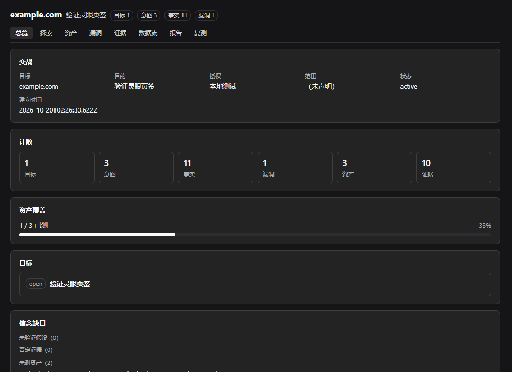
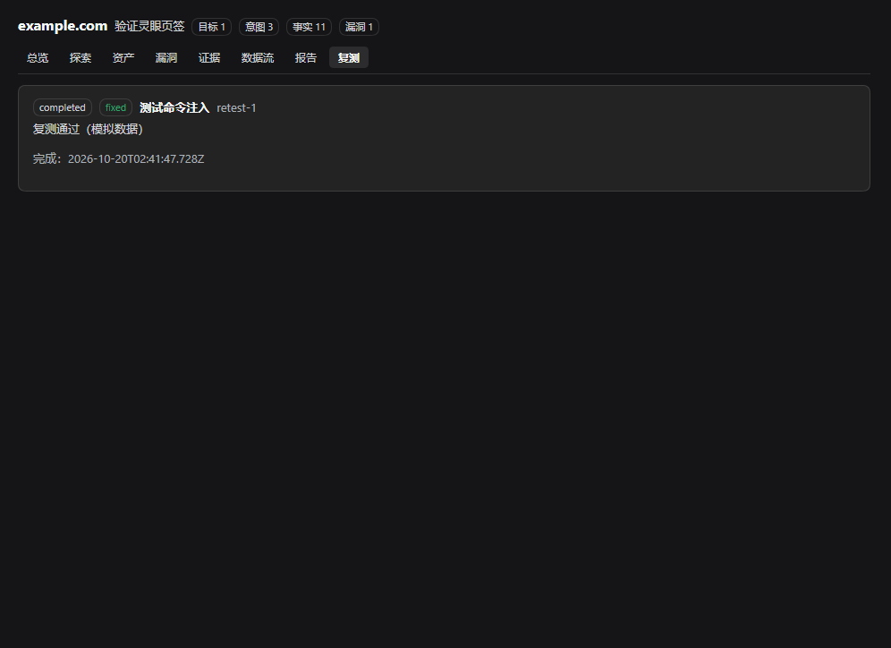

# dsh-lingeye（灵眼渗透测试模式）

面向 [DeepSeek Harness](https://github.com/deepseek-ai/deepseek-harness) 的授权安全测试模式。

灵眼不是普通功能插件，而是一个 **agent 模式**：新建会话时像「标准模式」「创造模式」一样选择「灵眼渗透测试模式」。进入后，指挥官 agent 维护目标、探索链路、资产、漏洞、证据与复测；执行与复测交给子 agent，所有记录落在一个共享的存储域里，并由 Web 页签实时展示。



## 它解决什么

渗透测试的难点不是"扫什么"，而是"下一步做什么实验最能改变判断"。灵眼把这件事落成数据：

- **探索图是 DAG-MDP 的信念状态**：goal → intent → fact → 新 intent → finding；事实带 basis（observed / inferred / assumed / negative）与置信度，否定结论和假设都保留。
- **意图是实验**：每条意图写清预期观测；利用动作同时是信息动作；失败落 negative 事实，不静默丢弃。
- **信息增益参与排序**：`ly_next` 按依赖就绪、优先级、覆盖缺口与信念缺口给出前沿，而不是待办清单。
- **交付物是一等公民**：漏洞带可复现步骤、证据、复测历史；报告与证据包可导出。
- 设计上把源码残留、拼接点、双层解码、token 信任边界都落成一等数据，而不是写在报告里的事后注释。

## 设计哲学

为什么把渗透测试当成不完全信息博弈，为什么探索图是 DAG-MDP，以及那四条安全经验怎样变成数据结构：见 [article/lingeye-philosophy.md](article/lingeye-philosophy.md)。

## 功能

- 探索链路：目标、意图、事实、漏洞、提示、约束、攻击路径。
- 资产图与覆盖率：资产按类型归一化去重；只有 finding 或带证据的事实才算"已测"。
- 证据：命令 / HTTP / 文本 / 文件，记录观测信道与逐层解释，正文按 sha256 内容寻址。
- 数据流：记录 source → transform → sink 的拼接点。
- 复测：独立复测记录，结论 reproduced / fixed / inconclusive，不覆盖原始漏洞。
- 报告与导出：`report.md`、`findings.json`、`assets.json`、`graph.json`、`coverage.json`、逐漏洞 Markdown、证据文件。
- 可选宿主调度器：侦察/执行子 agent 可由宿主按前沿自动派发。
- Web 页签：总览、探索、资产、漏洞、证据、数据流、报告、复测。



## 安装

需要 DSH `>= 0.2.1-rc.2 < 0.3.0` 与 Node.js `>= 22.5`（宿主自带）。

从本地目录安装（开发或内部分发）：

```powershell
dsh plugin --profile web add <path-to-dsh-lingeye>
```

从 tarball 安装：

```powershell
npm pack
dsh plugin --profile web add ./dsh-lingeye-0.1.0.tgz
```

安装后重启 DSH，新建会话时选择「灵眼渗透测试模式」。

## 新建会话选哪个模式

只选「灵眼渗透测试模式」。

「灵眼执行（子 agent）」和「灵眼复测（子 agent）」是给指挥官内部派发用的子 agent 预设，手动开这类会话拿不到完整的指挥、探索与报告流程。DSH 目前没有隐藏预设的字段，所以三个预设都会出现在选择菜单里；我们只能用名称标明它们的用途。等上游支持隐藏后会把这两个收起来。

## 开始一次测试

在会话里给出目标与目的即可，例如：

```text
目标是 example.com，目的是确认对外暴露面并验证一个可复现的低危问题，授权为本地测试。
```

指挥官会先调用 `ly_start` 建立交战；之后你可以让它继续推进，也可以自己用斜杠命令观察状态。

## 工具

指挥官：

| 工具 | 作用 |
| --- | --- |
| `ly_start` | 建立/重置交战：目标、目的、授权、范围、约束 |
| `ly_state` / `ly_next` | 读取完整状态 / 态势、前沿与信念缺口 |
| `ly_goal_add` / `ly_goal_prove` | 目标与达成判定 |
| `ly_intent_add` / `ly_intent_update` | 批量建意图（最多 4 条）/ 改意图状态 |
| `ly_hint_add` / `ly_constraint_add` | 注入策略提示 / allow-deny 约束 |
| `ly_asset_add` / `ly_evidence_add` / `ly_flow_add` | 资产、证据、数据流 |
| `ly_findings` / `ly_assets` / `ly_coverage` / `ly_review` | 漏洞、资产、覆盖率、复核 |
| `ly_report` / `ly_export` | 报告与交付包 |
| `ly_retest_create` / `ly_attack_path_add` | 发起复测 / 攻击路径 |
| `ly_dispatch_status` / `ly_dispatch_now` | 查看/手动运行宿主调度器 |

执行子 agent（`lingeye-worker` 预设）：`ly_fetch`、`ly_submit`、`ly_asset_add`、`ly_trace_append`。

复测子 agent（`lingeye-retest` 预设）：`ly_retest_begin`、`ly_retest_finish`。

## 宿主调度器（可选）

默认关闭。在 profile 的 `cordis.patch.yml` 里覆盖 store 行启用：

```yaml
- id: lingeye-store
  config:
    autoDispatch: true
    maxWorkers: 2
    debounceMs: 800
```

启用后，存储域发生变化会触发一次去抖派发：对当前有活跃会话的交战，按 `ly_next` 同样的依赖门控挑选 open 意图，用 `subagent` 的 `spawn` 通道拉起 `lingeye-worker`，结果回注父会话。每个意图只自动派发一次（避免失败循环），并发受 `maxWorkers` 限制；指挥官仍负责判定与收尾。

## Windows 说明（非系统盘工作区）

在 Windows 上，如果工作区位于 D:/E:/F: 等非系统盘，DSH 的 `workspace-write` 沙箱可能在命令 spawn 前失败：

```text
SetNamedSecurityInfoW failed (Win32 5): grantWrite(<workspace-path>)
```

这是上游已知问题（DSH 0.1.7+ 的 Windows ACL 沙箱：非系统盘目录默认没有当前用户 FullControl，沙箱打 Low 完整性标签需要 WRITE_OWNER）。灵眼**内置了社区修复**：`vendor/acl-sandbox-patch` 来自 [dsh-acl-sandbox-patch](https://github.com/masknull/dsh-acl-sandbox-patch)（MIT，见 [THIRD_PARTY_NOTICES.md](THIRD_PARTY_NOTICES.md)）。它不改任何系统 ACL，只在进程内包装沙箱自己的 FFI 调用：严格路径失败时降级为 DACL-only，并在降级环境跳过子进程降完整性。

补丁运行文件会复制到 `$DSH_HOME/lingeye-acl-patch/`，`NODE_OPTIONS` 指向那里的稳定 bootstrap；升级或卸载插件不会让子进程指向已删除的包路径。卸载后重启 DSH 才会清掉进程里残留的 `NODE_OPTIONS`。

Windows 上默认启用；如需关闭，在 profile patch 里覆盖该行：

```yaml
- id: lingeye-acl-patch
  config:
    enabled: false
```

## 兼容性

- DSH：`>= 0.2.1-rc.2 < 0.3.0`（`engines.dsh`）。
- 存储：`lingeye` 域使用 profile 默认后端（JSON）；记录按会话隔离，重启不丢。
- 客户端：手写 `window.__ModuleLoader__` 工厂，无构建步骤；页签只在该模式会话显示。
- 上游修复 ACL 问题后，可直接关闭内置补丁，行为与出厂一致。

## 开发

无需构建步骤：宿主半是 ESM JavaScript，客户端半是手写的 `__ModuleLoader__` 工厂。

```powershell
npm test        # node --test，报告与导出用例
```

本地调试：

```powershell
dsh plugin --profile <dev-profile> add <path-to-repo>
dsh --profile <dev-profile> --no-open --port 0
```

## 许可

MIT。Copyright (c) 2026 guaidao2 & coolmoon。内置的 Windows ACL 修复来自 dsh-acl-sandbox-patch（MIT），署名与许可见 [THIRD_PARTY_NOTICES.md](THIRD_PARTY_NOTICES.md)。

## 参考

- [dsh-pentest](https://github.com/howmp/dsh-pentest)（MIT，已归档）：工程基座与插件范式。
- [ARTEX](https://github.com/Hinln/ARTEX)（AGPL-3.0）：双图、planner/worker、复测、证据与报告。
- [Cairn](https://github.com/oritera/Cairn)（AGPL-3.0）：Fact / Intent / Hint 黑板、三种任务型与调度。
- [XuanMu-RedTeam-Agent](https://github.com/guaidao2/XuanMu-RedTeam-Agent)（MIT）：多角色协作、推理黑板、证据平面与攻击路径。

参考项目只借鉴设计与数据模型，运行时代码为本项目独立实现；内置 Windows ACL 修复是唯一随包分发的第三方代码，署名见第三方声明。
